<div align="center">


# Magpie

**Your own private archive for the things you find online.**<br />
Share a link from Instagram, TikTok, YouTube, Pinterest, X, Reddit or any web page. Magpie keeps the media, the caption and the context, even after the original post is gone.

[](../../releases)
[](LICENSE)


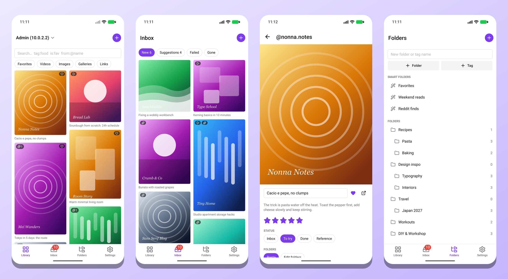

</div>

> [!WARNING]
> **AI-generated project.** As the `slop-` prefix says, the design, documentation and code in this repository were produced mostly by an AI coding agent. The project is provided as-is and will probably not be maintained. Issues and pull requests may go unanswered. Review the code before you rely on it.

## Why Magpie

Posts get deleted, accounts disappear, and "saved" folders inside social apps are hard to search and impossible to take with you. Magpie is a small server you run yourself plus an Android app. You send it a link, and it keeps a real copy on your own disk, filed where you will find it again.

- **Yours.** One private library per account, on your hardware, in your Postgres.
- **Permanent.** Media, caption, author and metadata are downloaded when you save, so the item survives the original.
- **Low effort.** Share from any app. Magpie suggests folders and tags, and you only review what it is unsure about.

## How it works

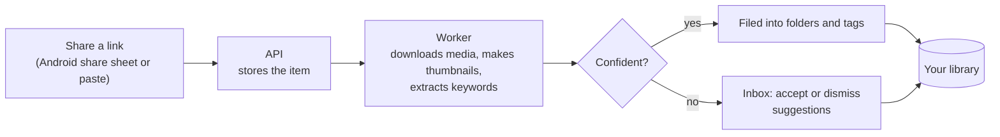

## Tour

<table>
  <tr>
    <td align="center" width="33%">
      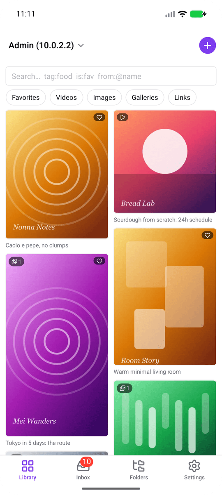<br />
      <b>Library</b><br />
      <sub>A masonry grid of everything you saved, with quick filters for favorites, videos, images, galleries and links.</sub>
    </td>
    <td align="center" width="33%">
      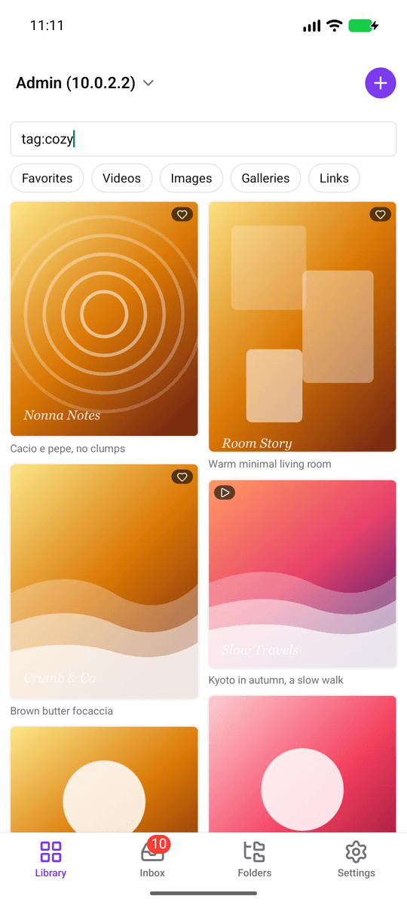<br />
      <b>Search that understands you</b><br />
      <sub>Full-text and fuzzy matching, plus operators like <code>tag:cozy</code>, <code>is:fav</code> and <code>from:@name</code>.</sub>
    </td>
    <td align="center" width="33%">
      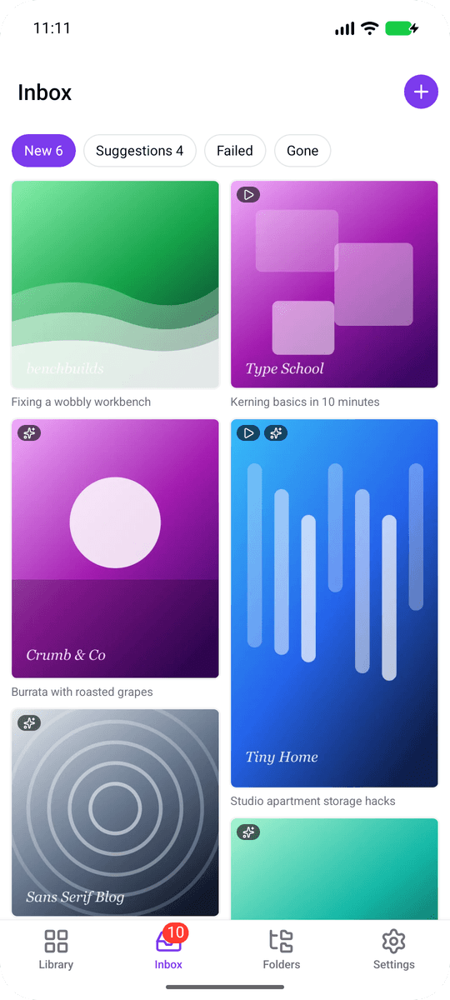<br />
      <b>Inbox</b><br />
      <sub>New items and low-confidence suggestions wait here. Failed fetches and posts that disappeared are flagged too.</sub>
    </td>
  </tr>
  <tr>
    <td align="center">
      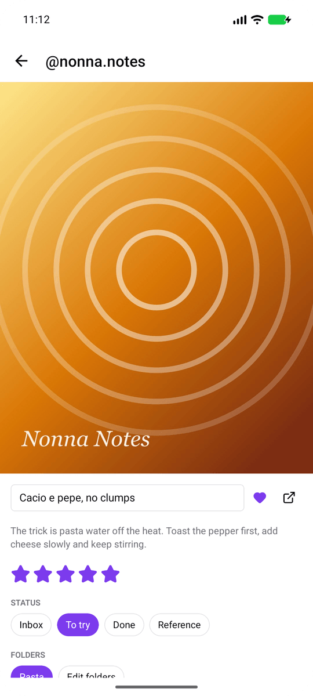<br />
      <b>Item</b><br />
      <sub>The full media, the original caption and author, a rating, favorites and a status: inbox, to try, done or reference.</sub>
    </td>
    <td align="center">
      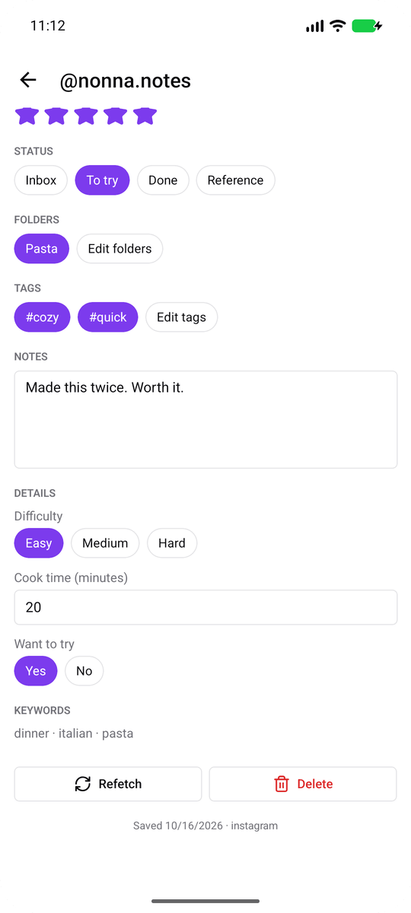<br />
      <b>Your own structure</b><br />
      <sub>Folders, tags, notes, auto-extracted keywords and typed custom fields such as a difficulty select or a cook time.</sub>
    </td>
    <td align="center">
      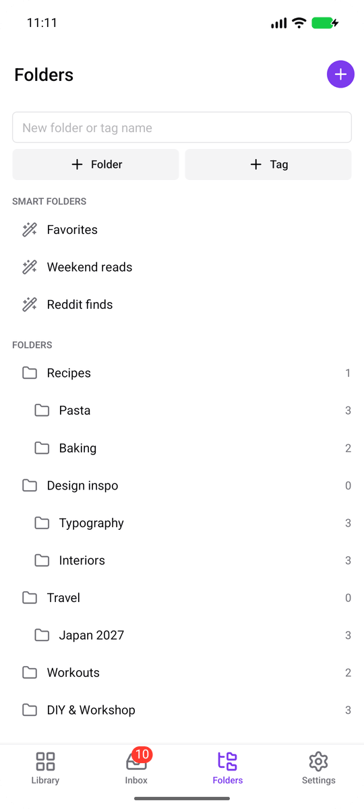<br />
      <b>Folders and smart folders</b><br />
      <sub>Nested folders (an item can live in several) and saved searches that stay up to date on their own.</sub>
    </td>
  </tr>
  <tr>
    <td align="center">
      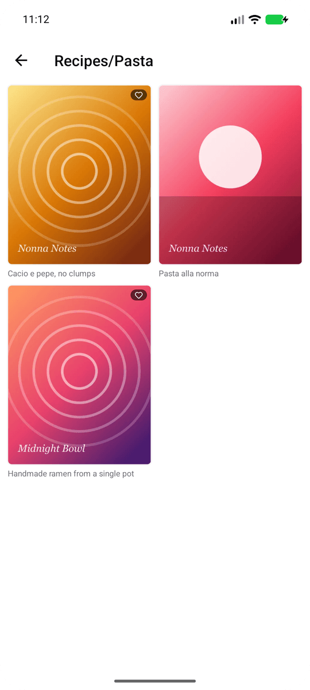<br />
      <b>Browse by folder</b><br />
      <sub>Open any folder to see just what is filed there.</sub>
    </td>
    <td align="center">
      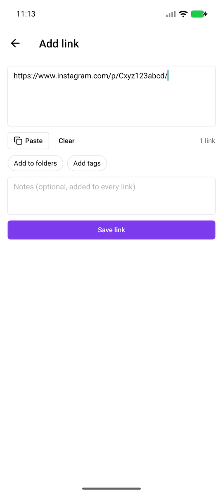<br />
      <b>Add links in bulk</b><br />
      <sub>Paste one link or a whole block of text, pick folders and tags up front, and see per link what happened.</sub>
    </td>
    <td align="center">
      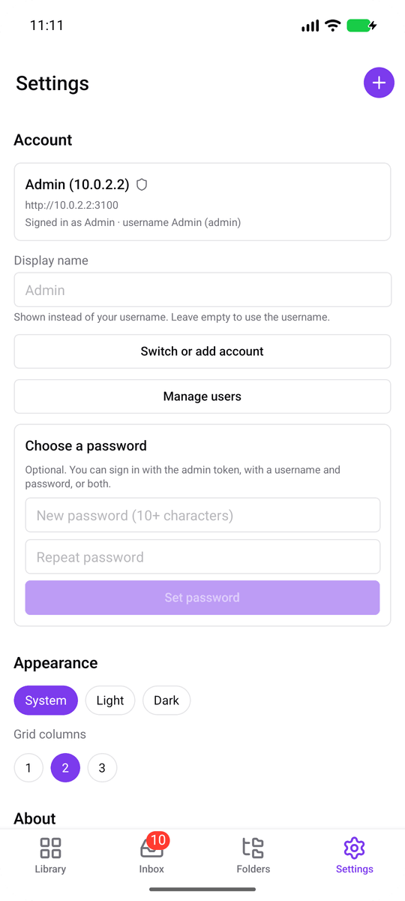<br />
      <b>Accounts and settings</b><br />
      <sub>Several servers on one phone, a password after your first token sign-in, theme and grid density.</sub>
    </td>
  </tr>
</table>

### Light and dark

The app follows the system theme, or you can pin either one.

<div align="center">
  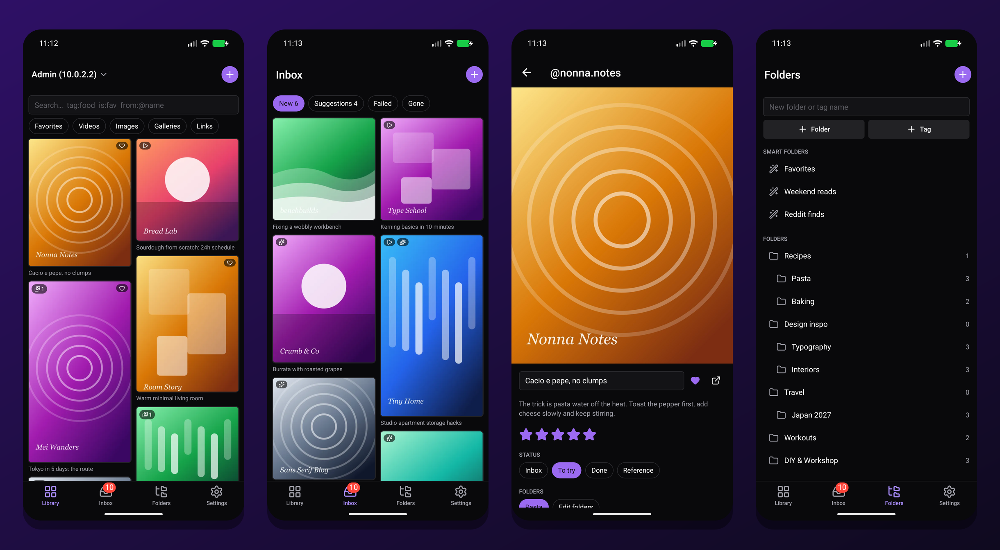
</div>

> The screenshots show a demo library made of generated artwork. No real posts are archived in them.

## Features

- **Save by link** from the Android share sheet or by pasting a URL, one or many at a time. Saving the same post again, even through a different link, finds the existing item.
- **Pluggable sources.** Each supported site is a separate module. Other URLs go through a generic fetcher (yt-dlp, gallery-dl, OpenGraph). See [docs/sources.md](docs/sources.md).
- **Full archive.** Media, caption, author and metadata are downloaded when an item is saved.
- **Thumbnails** for every item, taken from a video frame or a resized image.
- **Organization**
  - nested folders (one item can be in several)
  - tags
  - keywords, extracted automatically or added by hand
  - typed custom fields
  - notes, favorites, ratings and status
  - smart folders (saved searches)
- **Search** with full-text and fuzzy matching.
- **Auto-categorization.** Each suggestion has a confidence score. Low-confidence items wait in an inbox for review, and corrections improve later suggestions.
- **Source monitoring.** Items whose original has been removed are flagged.
- **Accounts.** Each account has its own library. The admin invites people from the app, and an invite link sets up a new phone in one tap.
- **In-app updates** that download the new APK and hand it to Android's installer.

## Architecture

| Component | Technology |
|---|---|
| Client | Expo (React Native), Expo Router, NativeWind, React Native Reusables |
| API | Node.js, Hono, zod |
| Worker | Node.js, pg-boss, yt-dlp, gallery-dl, ffmpeg, sharp |
| Database | PostgreSQL, Drizzle ORM |
| Storage | `BlobStore` abstraction (local filesystem; S3-compatible planned) |

All project code is TypeScript. yt-dlp and gallery-dl run as external command-line tools.

```
apps/mobile       Expo client
apps/api          HTTP API
apps/worker       background jobs and source fetchers
packages/shared   API contract (zod schemas) and source registry
packages/db       Drizzle schema and migrations
packages/storage  BlobStore interface and drivers
docs/             design documentation
```

## Status

The server (API, worker pipeline, search, organization, auto-categorization, accounts) and the Android app are implemented. Each [release](../../releases) ships a prebuilt APK. iOS and web are not built yet. See the [roadmap](docs/roadmap.md).

## Getting started

Requirements:

- Node.js 24+
- pnpm 10+
- PostgreSQL
- `yt-dlp`, `gallery-dl` and `ffmpeg` on `PATH` (worker only)

```sh
cp .env.example .env   # set DATABASE_URL, API_TOKEN, MEDIA_SIGNING_SECRET
pnpm install
pnpm db:migrate
pnpm dev
```

Then install the APK from the latest [GitHub release](../../releases), enter your server address and the `API_TOKEN` (or open an invite link), and share your first link.

See [docs/deployment.md](docs/deployment.md) for production setup (a Docker Compose file is included, built for `linux/arm64`, targeting a Raspberry Pi 5 under Coolify). Server images are published to GHCR. Changes are listed in [CHANGELOG.md](CHANGELOG.md).

## Documentation

- [Architecture](docs/architecture.md)
- [Data model](docs/data-model.md)
- [API](docs/api.md)
- [Sources](docs/sources.md)
- [Worker pipeline](docs/worker-pipeline.md)
- [Storage](docs/storage.md)
- [Security](docs/security.md)
- [Deployment](docs/deployment.md)
- [Releases](docs/releases.md)
- [Design decisions](docs/decisions.md)
- [Roadmap](docs/roadmap.md)

## License

[MIT](LICENSE) © 2026 Sandoramix. yt-dlp, gallery-dl, ffmpeg and the npm dependencies keep their own licenses.
